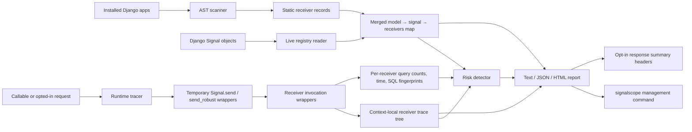

# SignalScope: a Django signal and side-effect tracer

SignalScope makes Django signal wiring visible. It statically scans installed
apps, reads live signal registrations, traces receivers and database activity,
and reports common side-effect risks.

## Architecture and workflow



1. **Discover:** the scanner parses Python files in installed apps and records
   `@receiver(...)` decorators and `Signal.connect(...)` calls with source
   locations.
2. **Merge:** the registry resolves live weak references from Django signals,
   discovers custom signals exposed by loaded apps, and combines runtime data
   with static records. Unresolved sender models remain visible.
3. **Trace:** `trace_signals()` temporarily instruments signal dispatch.
   Receiver calls are recorded as a context-local tree, with nesting,
   durations, instance labels, and per-receiver database query statistics.
4. **Analyze:** the risk detector checks the trace and static sender records for
   circular re-entry, repeated/high query counts, slow receivers, deep chains,
   and orphan senders. Thresholds come from `SIGNALSCOPE`.
5. **Report:** the management command emits text, JSON, or an HTML report. The
   middleware traces only explicitly opted-in requests while both `DEBUG` and
   `SIGNALSCOPE["ENABLED"]` are true.

In the demo, saving an `Order` updates `Product` stock; the product receiver
saves its related order again. Other demo receivers intentionally issue
repeated queries, sleep, create a four-step nested signal chain, and connect to
an unresolved sender.

## Requirements

- Python 3.11+
- Django 4.2 or 5.x
- No runtime dependencies beyond Django

## Install and configure

```shell
pip install django-signalscope
```

Add SignalScope to `INSTALLED_APPS` so Django can discover its management
command and HTML template. The configured Django template backend must use
`APP_DIRS = True` (as in the default `startproject` settings):

```python
INSTALLED_APPS = [
    # ...
    "signalscope.apps.SignalScopeConfig",
]

SIGNALSCOPE = {
    "MAX_QUERIES": 5,
    "SLOW_MS": 100,
    "MAX_DEPTH": 3,
    "ENABLED": DEBUG,
}
```

The app does not install middleware automatically. To opt in to request traces,
add `signalscope.middleware.SignalScopeMiddleware` to `MIDDLEWARE`. A request is
traced only when `DEBUG` and `SIGNALSCOPE["ENABLED"]` are true and the request
includes either `X-SignalScope: 1` or `?signalscope=1`. Responses include
`X-SignalScope-Receivers` and `X-SignalScope-Risks`.

## Management command

Build a static and live receiver map:

```shell
python manage.py signalscope --map
python manage.py signalscope --map --format json --output signals.json
```

Run a zero-argument callable while tracing its signal receivers:

```shell
python manage.py signalscope \
  --trace myapp.diagnostics.run_signal_workflow \
  --format html \
  --output signals.html
```

The callable may be synchronous or asynchronous. Supported formats are
`text`, `json`, and `html`. `--fail-on-risk` returns a non-zero command status
after writing the report if any risks were found:

```shell
python manage.py signalscope --map --fail-on-risk
```

## Python API

```python
from signalscope.registry import build_receiver_map
from signalscope.risks import detect_risks
from signalscope.tracer import trace_signals

with trace_signals() as trace:
    order.save()

receiver_map = build_receiver_map()
risks = detect_risks(trace)
```

`trace_signals()` can also be used as a decorator with `@trace_signals()`.

## Demo and tests

The repository includes a three-app demo project with intentional circular,
query-heavy, slow, deep-chain, and orphaned signal wiring.

```shell
python -m pip install -e ".[dev]"
python -m pytest
python manage.py signalscope --trace demo_project.trace_example.trace_workflow --format html
```

## Report screenshot

> Screenshot placeholder — add a capture of the generated HTML report here.
